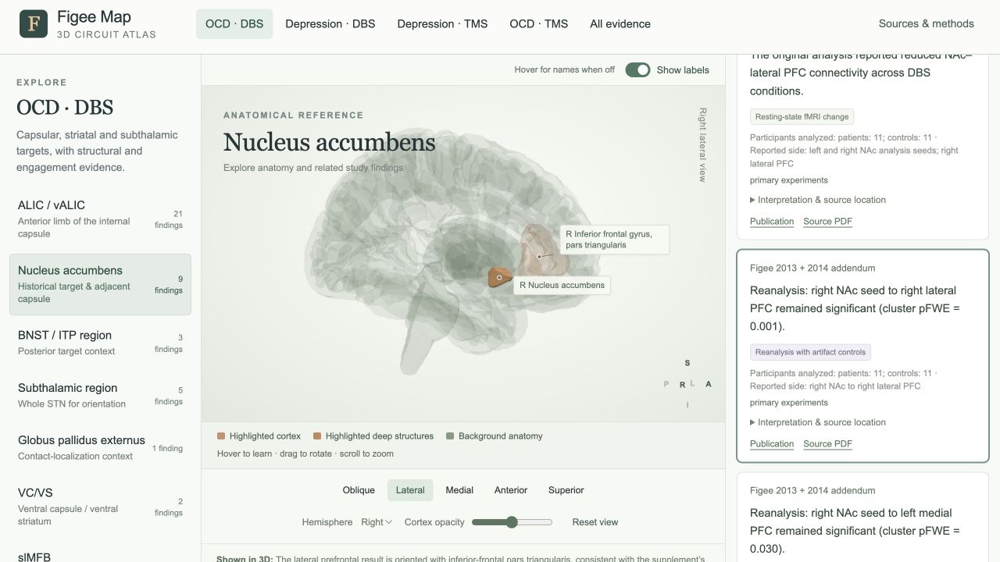
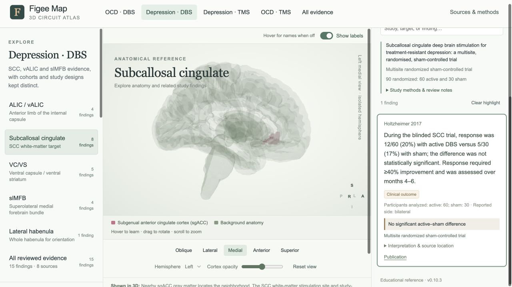

# Evidence and anatomy QA · v0.10.3

Reviewed 1 October 2026. All 76 findings were selected in the live atlas,
followed by all 200 available finding/target combinations across the four
clinical sections. Verified discrepancies were corrected. The pass also checked
96 mesh transforms/bounds, 33 tract coordinate files and both functional-map
volumes. No geometry files were rebuilt or moved.

## Corrected defects

| Severity | Reproduce in v0.10.2 | Problem and correction |
| --- | --- | --- |
| High | OCD DBS → NAc → Figee FM015/FM016/FM018 | Lateral PFC was represented using middle-frontal/DLPFC parcels, although the supplement labels the region BA45. These findings now use inferior-frontal pars triangularis as a **gross anatomical approximation**, with the limitation and source basis recorded. The exact fMRI clusters remain unavailable. |
| Medium | NAc → Figee FM013–FM018 | Specified sides were lost in several records. FM013 now identifies the **right NAc** reward-related result; the original connectivity records retain **left medial PFC and right lateral PFC**, with left/right NAc analysis seeds. FM018 preserves its left seed, left medial and right lateral comparisons; the two nonsignificant cortical comparisons remain blue context instead of being promoted to confirmed effects. |
| Medium | Depression TMS → DLPFC → Cole | Bilateral sgACC targeting references were marked unspecified. Both sgACC surfaces now retain the reported bilateral role, separately from left-DLPFC stimulation. |
| Medium | OCD TMS → dmPFC → Dunlop 2016 | Bilateral caudate/thalamic changes lost their sides, while NAc appeared as an additional region without a separately identified NAc result in the displayed finding. The card now identifies bilateral caudate/ventral-striatal and thalamic connectivity; the separate NAc assignment was removed. This still represents only a subset of the distributed findings. |
| Medium | Depression TMS → Insula-guided DLPFC, before selecting a card | DLPFC was highlighted bilaterally despite the view describing left-DLPFC targeting. The initial view now uses left DLPFC and right insula. |
| High | Depression DBS → SCC → Holtzheimer or an SCC-only outcome card | Selecting a finding removed the sgACC landmark because SCC white matter has no mask. All SCC findings now retain a distinct pink **nearby sgACC landmark**, without claiming that it is the white-matter stimulation site. Its legend and hover explanation identify the distinction. |
| Medium | All evidence → a TMS finding | Selecting TMS evidence cleared its underlying tract context. The All evidence overview now uses the finding's sourced primary-target TMS preset. Multi-target studies retain their separate target views; this is not a reconstruction of every arm or a merged treatment protocol. |
| Medium | All evidence → capsular, amSTN, LHb or midbrain findings | Target-view warnings did not reliably follow findings into other views. Captions and anatomy summaries now follow the selected finding and name whole-structure substitutes or missing geometry explicitly. |
| Medium | Fox, Fitzsimmons and frontal EEG findings | A seed-center coordinate could be read as defining a whole right-sided sgACC ROI; treatment-arm shading could be read as an activation mask; scalp EEG could be read as localized cortical generators. The atlas now states these distinctions. Fox's right-of-midline coordinate is unchanged; surrounding sgACC surfaces are bilateral reference context. Hover notes expose specific roles such as analysis seed, stimulation arm or measured change. |

Functional-map notes also explain that the released map has its own spatial
extent, and that regional surfaces can be hidden while it is displayed. Surface
colors are not individual treatment sites or statistical significance. Hover
references include the selected study when describing its displayed anatomy.

## Source basis for changes

- Figee 2013/addendum: main Figure 1 and supplied supplement F053, Table 2
  (PDF p. 4), Tables 3–4 (pp. 4 and 6), and artifact-controlled Table 6 (p. 8).
  The source distinguishes right versus left reward responses, both NAc seeds,
  BA45 lateral PFC, cortical comparison sides and corrected P values.
  [Publication](https://doi.org/10.1038/nn.3344).
- The BA45-to-pars-triangularis correspondence is an anatomical approximation,
  not an equality between a gyral parcel and cytoarchitecture.
  [Anatomical account](https://pmc.ncbi.nlm.nih.gov/articles/PMC1569489/).
- Cole: supplied Supplement 1, PDF p. 3, describes left-DLPFC and bilateral
  sgACC functional subunits. [Publication](https://doi.org/10.1176/appi.ajp.2021.20101429).
- Dunlop: Results on treatment-related connectivity, Table 1 and Figure 2,
  checked in the cached full text. A fresh PMC request encountered an access
  challenge; no claim of fresh full-text retrieval is made.
  [Article](https://pmc.ncbi.nlm.nih.gov/articles/PMC4793124/).
- Fox: Table 1 and Methods distinguish a seed coordinate from its ROI;
  coordinates were not changed or enlarged into a new study mask.
  [Article](https://pmc.ncbi.nlm.nih.gov/articles/PMC4120275/).
- Fitzsimmons: the published abstract supports separate left-DLPFC and left
  pre-SMA treatment arms. The prior full-text access limitation remains.
  [Publication](https://doi.org/10.1016/j.biopsych.2024.06.029).

The previous [citation audit](CITATION-AUDIT-v0.10.2.md) supplies the remaining
source-review bases. This was not a fresh complete reading of every paper.

## Verification

- **76/76 finding selections** recorded actual loaded mesh visibility, material
  role/color, tracts, markers, maps and source-specific captions.
- **200/200 clinical finding/target combinations** selected the expected record;
  final changed Figee combinations were rechecked after their corrections.
- **96 mesh files:** GLB accessor bounds after node transforms match atlas
  bounds within 0.11 mm; left/right centroid signs match their labels. This
  detects representation errors, not anatomical registration accuracy.
- **33 tract files:** finite coordinates, point counts and geometric bounds
  match their manifests. **Both maps:** every stored voxel matches the bundled
  source NIfTI, and the inverse coordinate transform agrees with its affine.
- **45 regression groups**, JavaScript syntax checks and citation checks pass.
  No errors were captured in the browser's error log.
- Visual inspection covered the corrected right inferior-frontal/NAc display
  and medial SCC landmark; NAc hover identifies its analysis-seed role.

[Per-finding and clinical-view audit](display-audit-v0.10.3.json) ·
[Verification record](verification-v0.10.3.json)

## Remaining limits

The display is still an educational anatomical reference. Existing broad
medial-frontal, dACC and other cortical proxies do not reproduce study ROI
boundaries. The BA45 approximation is also not a reconstructed fMRI cluster.
Exact refinement requires the corresponding masks or sufficiently detailed
source definitions, followed by documented registration.

SCC white-matter stimulation volumes, ALIC/vALIC treatment boundaries,
anteromedial STN and lateral-habenula subdivisions, and the study-defined
midbrain branches remain undelineated. Generic bundles do not reproduce
patient-specific intersections or stimulation fields. Five clinical findings
retain abstract-level source verification.

The meshes, regional masks and pathways retain their existing native template
coordinates. This pass did not establish millimetre-level cross-template
alignment or patient targeting accuracy. Functional-map cortical projections
omit deep voxels. A full literature-coverage, accessibility, responsive-layout
or performance audit was outside this pass.
