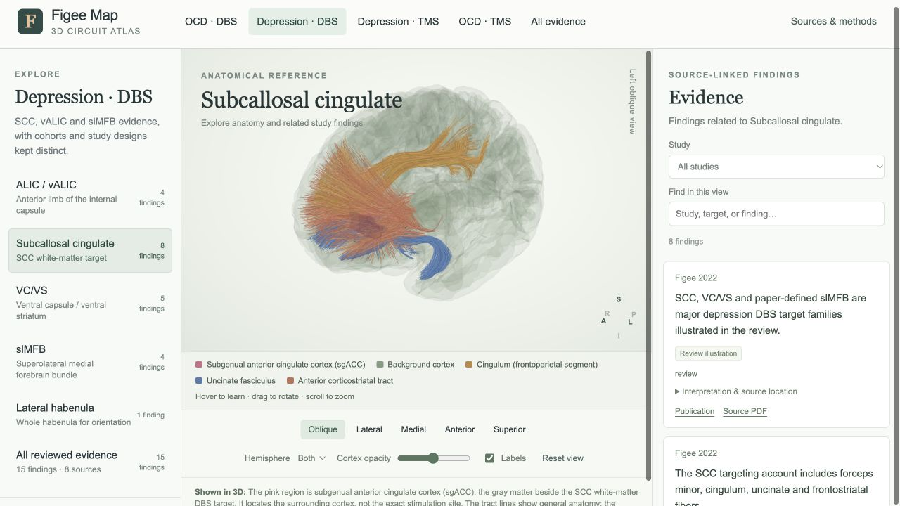

# Terminology and interface QA — v0.9.5

Current pathway availability is updated in [the v0.10 public-data audit](PUBLIC-DATA-AUDIT-v0.10.md). This report preserves the earlier v0.9.5 state.

Checked 30 September 2026. This pass examined the working desktop atlas, its
navigation, display controls, legends, labels, callouts and evidence presentation.
It did not independently re-review every clinical paper or validate spatial
registration against new imaging data.

## Findings and corrections

| Finding | Correction |
| --- | --- |
| “Anterior corticostriatal” and “superior corticostriatal” are incomplete display names. | Added **tract** consistently to controls, legends and hover titles. The cingulum is identified as its **frontoparietal segment**. Radiation, fasciculus and commissure retain their established anatomical names. |
| Repeated “atlas” suffixes and “gray-matter reference” cluttered the legend without explaining what users were seeing. | Legend keys now name visible structures. sgACC is expanded to **subgenual anterior cingulate cortex**. The SCC caption and Sources & methods explain that this cortical region is beside the white-matter DBS target, whose precise location is unavailable. |
| The legend occupied the same canvas as the brain and competed with anatomical labels. | Moved it into a dedicated footer below the canvas. Labels retain connecting lines; label/callout placement reserves space for the heading. |
| Checked but invisible regional layers could remain represented as colored legend entries. | Keys reflect rendered anatomy, including zero-opacity and hemisphere filtering. Functional-map mode has a plain notice explaining how to restore region shading. |
| Coordinate colors lacked an adjacent identity key, and functional-map color scales were separated from the model. | Added keys for connectivity-analysis and candidate-TMS coordinates. Moved the continuous functional-map key next to the image. Coordinates remain distinguishable from anatomical regions and stimulation extents. |
| Hover cards repeated technical classification tags alongside explanatory prose. | Kept the structure name, brief explanation and source names. Removed redundant role classifications for anatomical structures and tracts; point roles remain because they distinguish analysis seeds from candidate stimulation sites. |
| “Round 2”, unexplained record codes and unspecified-laterality fragments appeared prominently in cards. | Removed collection-round tags from cards, moved record IDs and missing-laterality explanations into source details, and used readable evidence-type labels. Detailed study methods and review notes are expandable. Finding text, limitations, participant counts and controlled outcomes remain intact. |
| Region and target acronyms were often unexplained; target counts were floating numbers. | Expanded regional names and major target subtitles. Counts now explicitly say “finding” or “findings”. |
| Study choices included papers unrelated to the current target and silently switched to the overview. | Limited choices to papers with findings in the current topic and target. Invalid saved study/target combinations reset the study filter while preserving the target. |
| An empty text search incorrectly blamed the selected study. | Added a search-specific explanation and a working **Clear search** action. |
| Functional-map and coordinate controls appeared in views where they had no effect. | Hide unavailable controls while keeping an off coordinate toggle available whenever that view has coordinates to display. |
| Every evidence overview highlighted a fixed set of OCD nuclei, including depression and TMS overviews. | Overviews now start without arbitrary anatomical highlights. Tract presets, optional region layers and selected-finding highlights remain available. |
| The SCC caption continued to describe its default pink highlight after a finding changed the anatomy. | Selecting an SCC finding now shows a finding-specific caption. |

The terminology check used the source laboratory’s
[White Matter Tracts teaching material](https://practicum.labsolver.org/wmt.html)
and [HCP1065 atlas documentation](https://brain.labsolver.org/hcp_trk_atlas.html).
These identify anterior/superior corticostriatal subdivisions and cingulum
subcomponents. This changes display terminology, not the tract files or their
anatomical interpretation.

## Verification

- JavaScript syntax checks and **29 regression groups** passed. Added checks cover
  relevant study filters, invalid saved study/target combinations and neutral
  evidence overviews. Existing laterality, study-map, controlled-trial, regional
  boundary, hover, opacity and URL checks remain in place.
- Visited **48 topic/target combinations**: 9 OCD DBS, 6 depression DBS,
  7 depression TMS, 6 OCD TMS and 20 overall-atlas views. Inspected titles,
  finding counts, study choices, legends and control availability. The first
  automated OCD navigation preceded load completion; it was repeated after
  the atlas finished loading.
- Exercised comparison-map selection and clearing by a Fox finding, study
  filtering, empty-search recovery, coordinate toggles, region overlap,
  zero regional opacity, functional-map pausing, reset and medial viewing.
- Hovered the left anterior corticostriatal tract. Its light, anchored callout
  used the complete name and source labels; the selected tract remained at
  0.95 opacity and the other tract at 0.425. Escape dismissed the callout.
- Checked SCC default and controlled-trial finding states. The default legend
  identifies sgACC; the selected-finding caption no longer falsely describes
  the default pink region.
- Visually inspected the natural **1280 × 720** desktop browser view. The legend
  is outside the brain canvas, and there is no document-level horizontal overflow.
- No captured browser warnings or errors. All 18 configured local PDF files exist.
- All **76 findings, 32 clinical sources, anatomical assets and original source
  PDFs** are unchanged. Clinical interpretation limits have not been removed.

## Remaining limitations

- This is a desktop UI and data-consistency check, not clinical or anatomical
  validation. Patient-specific tractograms, precise treatment masks, electrodes,
  electric fields and several named pathway geometries remain unavailable.
- Existing regional boundaries and cross-template alignment remain approximate.
  Naming or repositioning their legends cannot improve the underlying geometry.
- Shared links retain camera presets, but not the exact angle of a freely rotated
  view. This existing limitation was not changed in the terminology pass.
- Phone-size layouts, touch behavior and assistive-technology operation were not
  audited in this pass. Native keyboard focus styling was added, but that is not
  a claim of complete accessibility testing.

Detailed checks and inherited scientific limits are in
[verification.json](../verification.json).
