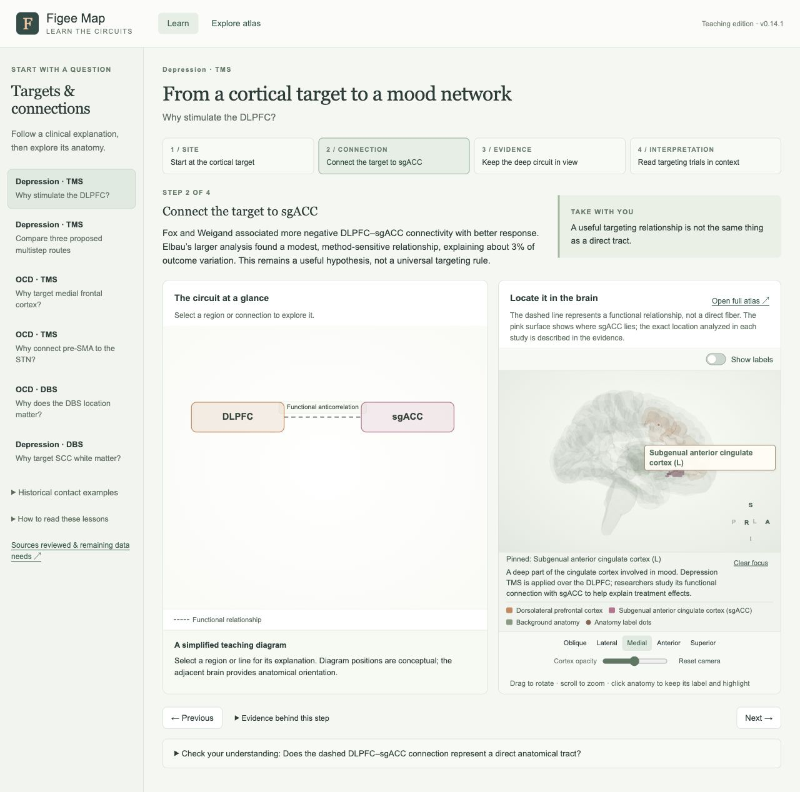

# Teaching interaction and wording QA · v0.14.1

Reviewed 2026-10-02. Scope: the user's missing pinned label in Learn → Depression
TMS → Step 2, equivalent selection behavior across the renderer, and explanations
that should teach a region's role rather than lead with atlas implementation terms.

## Findings and fixes

| Finding | Correction |
| --- | --- |
| Clicking sgACC retained its material highlight and the small “Pinned” status, but the floating name disappeared with the hover card. Learn starts with automatic labels off. | A selected anatomy surface, tract or study point now retains one connected name independently of Show labels. Its explanation remains below the brain. |
| Broad region surfaces had no label entry when their optional centroid dots were disabled. Tracts had no persistent name entry either. | Selection creates a label and leader for either type, without adding a coordinate dot. Study points keep their existing role color and location. |
| Pinned names could be truncated in the status row or lose space to other floating labels. | The status wraps and the selected name has placement priority. The teaching frame has room for its explanation below the model. |
| The same teaching scene message cleared a pin and reset the camera. | Re-selecting the current step preserves the pin. A different step, lesson or diagram selection clears it. |
| Generic hover copy could describe DLPFC as a TMS entry point in an OCD DBS lesson. Other regions likewise ignored the current lesson. | The diagram and 3D anatomy now share the same source-linked, side-matched node description. DLPFC is connected cortex in the amSTN DBS example. |
| sgACC was explained primarily by contrasting an analysis seed and white-matter target. | The TMS lesson now starts with its mood-network role and explains that stimulation is over DLPFC. The SCC DBS lesson explains nearby white matter separately. Its actual cortical surface is still named sgACC, never mislabeled as the DBS target. |
| Other hover descriptions leaned on terms such as “supplies specific anatomy” or unexplained atlas estimates. | Thirteen anatomy descriptions were clarified, including pre-SMA, dmPFC, VLPFC parcels, caudate, putamen, pallidum, insula and mediodorsal thalamus. GPe explicitly distinguishes recording from ALIC stimulation, using the existing Imtiaz source. |

The sgACC teaching explanation is now:

> A deep part of the cingulate cortex involved in mood. Depression TMS is applied
> over the DLPFC; researchers study its functional connection with sgACC to help
> explain treatment effects.

The adjacent caption continues to distinguish a functional relationship from a
direct fiber and a broad anatomical region from a specific study analysis location.
No new clinical efficacy claims, stimulation fields, geometry or coordinates were added.
All 94 findings and 39 evidence sources remain available.

## Interaction behavior

- Click a colored, interactive structure, tract or point to keep its name and highlight.
- Hovering other structures can still show their descriptions without changing the pin.
- Label toggles, rotation, zoom and compatible appearance controls retain the selection.
- Click the same element again, click empty space, press Escape or choose Clear focus
  to release it. Hiding selected anatomy or changing clinical/teaching context clears it.
- Background anatomy remains passive. Pinning does not enable background hover or
  convert a regional estimate into a treatment point.
- A pin is a temporary viewing selection; reloading the page clears it.

## Verification

- Reproduced the original issue in the user's Learn view: pinned sgACC status with
  zero visible floating names while Show labels was off.
- Opened all six lessons and all 24 steps through browser controls, checking scene
  identity, available anatomy and absence of renderer errors. SCC Step 1 uses its
  neighboring cortical context surface, not a reconstructed white-matter target.
- Exercised sgACC and DLPFC selection in TMS and DBS teaching contexts; confirmed
  the different explanations and removal of stale labels on step changes.
- Exercised anatomy, anterior corticostriatal tract and published sgACC analysis
  point selection in the shared renderer. Confirmed label persistence with labels
  off, point-role color, pointer exit, labels on/off, camera controls, dragging,
  zoom, Clear focus, Escape, repeated tract clicks and empty-space clicks.
- Verified re-selecting the current teaching step preserves the selected sgACC label.
- Inspected the final teaching layout at the browser's desktop size. No browser
  errors or warnings were reported during these checks.
- Passed JavaScript syntax checks and 52 atlas, 11 teaching and 5 evidence-curation
  regression groups, plus the citation integrity check. New teaching checks cover
  side-specific explanations, TMS versus DBS roles and unique HTML element IDs.

[Recorded browser observations](teaching-interaction-checks-v0.14.1.json)

## Boundaries of this pass

This was an interaction and teaching-language QA pass, not a new literature review
or validation of individual stimulation anatomy. Every teaching step was opened;
every mesh, tract file and possible camera angle was not individually clicked.
Touch-device and cross-browser testing were not performed.
