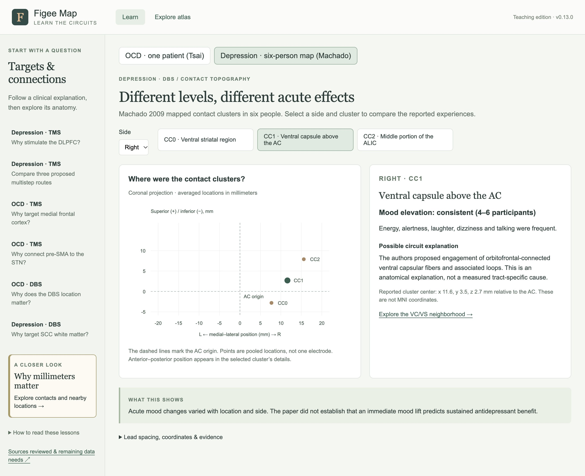

# Routes and contact topography · v0.13.0

2 October 2026. Teaching draft; not yet reviewed by Dr. Figee.

## Additions

The atlas now contains **94 findings from 39 sources**. Six new findings draw on
Seguin 2026 and Machado 2009. Their local full-text links include page locators;
original PDFs and source spreadsheets are not redistributed.

**Learn the circuits** now has six lessons and 24 steps. The new Seguin lesson
compares three alternatives, using a distinct “Proposed route · connectome model”
line style:

1. Left DLPFC → right dorsal superior frontal gyrus → right anterior cingulate
   → right subgenual cingulate (SGC/sgACC).
2. Left DLPFC → left thalamus → left medial superior frontal cortex → right
   medial superior frontal cortex → right SGC.
3. Left DLPFC → right dorsal superior frontal cortex → right thalamus → right
   medial superior frontal cortex → right SGC.

These follow main Figure 2 and Supplementary Figures S7, S6 and S8, respectively.
The fourth step covers the clinical associations and their limits. A graph hop
is a modeled connection between parcels, not a millimeter or an observed synapse.
The cohorts reuse published clinical data; this is not a new treatment trial.

Selecting a node or connection changes the adjacent reference anatomy. Mixed
left/right routes retain each node's laterality; the opposite hemisphere is not
colored as though it belonged to that node. Broad atlas regions are explicitly
separated from the small Lausanne parcels. Cingulum or anterior thalamic radiation
bundles provide anatomical orientation and are not relabeled as Seguin's actual
paths. No direct DLPFC–sgACC fiber or synthetic intervening streamline is added.

**Why millimeters matter** now has two examples. The prior Tsai OCD case preserves
its 3-mm contact-center spacing. Machado's six-person depression study adds an
interactive coronal plot of CC0–CC2 cluster centers, with side and cluster controls,
reported acute effects and explanatory hypotheses. Both plotted axes use the same
millimeter scale. The anterior–posterior coordinate is given in the selected details.

Machado coordinates are relative to the posterior-inferior AC margin, in an AC–PC
aligned frame, not MNI. They are averages of retained contacts, not one person's
lead. Most implants used modified 3387 INS leads with 3-mm contacts and 4-mm gaps
(7-mm center spacing); one left implant used a standard 3387. CC3 was too dispersed
for response clustering and is not presented as an equivalent fourth cluster.
Immediate mood elevation is kept separate from sustained antidepressant benefit.
The paper cannot assign a unique causal tract to an individual contact's effect.

## Source-data checks

All three supplied Seguin workbooks were read without modification. Independent
recalculations gave:

| Data | Check |
|---|---|
| Figure 1C | n = 25; Spearman rho = −0.510585; one-sided p = 0.004554, agreeing with the published −0.51 / 0.0046 |
| Figure 2B | 737,592 hop entries, with the complete histogram retained in the audit |
| Figure 3C | n = 837; rho = 0.477187, agreeing with 0.48 |
| Figure 3F | n = 929; rho = 0.754269, agreeing with 0.75 |

The published first-cohort result is not equated with every analysis passing
correction: two of four cohort/connectome combinations survived correction across
nine network measures. The paper did not demonstrate a significant advantage over
the functional-connectivity predictor. Regional/route percentages in Figure 2 are
not interpreted as treatment response rates.

The public analysis repository was pinned to commit
`067385f040eea215ed092afdc8e0332ad55b290d`. Its matrices, labels, parcellation volume,
affine, direction masks, cohort I coordinates and relevant MATLAB routines were
inspected. Upstream scripts were not executed. Both stored structural matrices
respect their supplied direction masks. All 25 Figure 1B voxel-index coordinates
transform exactly to the released adjusted MNI coordinates. The seed index
(42, 71, 31) transforms to MNI (6, 16, −10). Centroids require MATLAB's one-based
voxel convention. No spreadsheet voxel index was added as a millimeter marker.

This is targeted numerical verification, not full reproduction of all null models,
cohort II analyses or patient tractography. The audit retains original-file hashes,
aggregate outputs and exact source locators, without participant-level data copies.

## Source discrepancies handled

- Seguin's Results and Methods reverse cohort-specific BDI/MADRS labels. The lesson
  uses percent symptom improvement without resolving the inconsistent labels.
- Seguin's prose has inconsistent signs for a contralateral SGC coordinate; the code
  uses (−6, 16, −10). No new coordinate point is added from that passage.
- Machado Table 2 duplicates right-CC1 mood elevation under different categories.
  Results and Discussion agree on “consistent,” which the view uses and explains.
- Machado's text and Table 4 summary differ on intra/postoperative agreement. That
  summary percentage is not included in the teaching view.

## Verification and remaining scope

Run the JavaScript syntax checks plus `check-regressions.mjs`,
`check-citations.mjs` and `check-teaching.mjs`. Teaching regression coverage includes
all lesson/selection URL states, three route topologies, hemisphere-specific nodes,
six Machado coordinate triplets, reporting missingness and the distinct lead spacing.
Live checks and their limits are recorded in [the verification record](teaching-verification-v0.13.json).

The two requested full texts are resolved. Remaining requirements concern spatial
data and clarification of Figee's particular teaching example; see
[the access/data list](TEACHING-ACCESS-v0.13.md). This release adds no patient-level
contact registration, stimulation field, exact study route tractogram or predictor.

[Source/data audit](round4-source-review-v0.13.json) ·
[Teaching claim crosswalk](teaching-review-v0.13.json)

