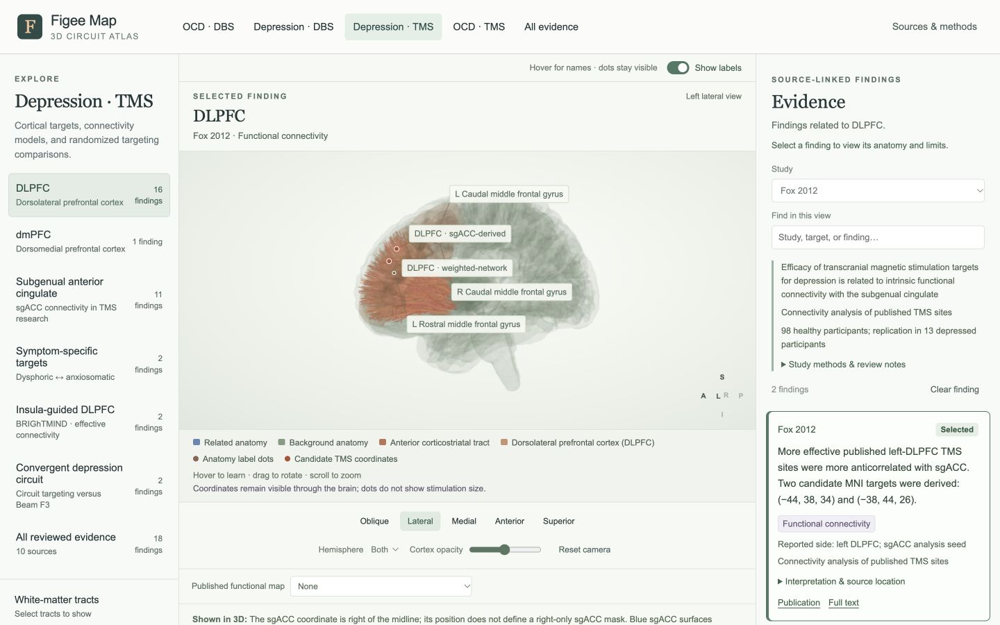

# Visual communication and clarity QA · v0.11.2

Reviewed 1 October 2026. This pass concerns how readily a reader can understand
and operate the atlas: visual hierarchy, legibility, selection feedback, label
placement, legend meaning, controls, and movement between anatomy and evidence.
It is not an ADA/WCAG compliance review or a specialist disability/color-vision
audit. It does not repeat the scientific evidence or citation audits.

## Corrections

| Observed issue | Change |
|---|---|
| Long scene titles, especially “Convergent depression circuit,” covered the brain. The orientation text was vertical and easy to miss. | Moved the title and horizontal orientation readout into a separate header. Floating labels and hover callouts use the full canvas without colliding with that header. |
| Selecting evidence changed the map without a clear study identifier beside it. Cards looked like ordinary paragraphs. | Added the selected source and finding type above the brain, an explicit Selected badge on the active card, a clearer card border, a hover background on finding buttons, and a short instruction in the Evidence panel. Comparison maps retain their explicit warning. |
| Metadata, badges, source links, captions, and labels were small or faint. | Increased and darkened secondary text, enlarged floating labels to 12 px, and improved text spacing. The background cortex and anatomical color assignments remain unchanged. |
| “Reset view” also cleared selected evidence, regions, opacity values, and label preferences. | Replaced it with Reset camera, which restores the oblique camera while preserving study, finding, hemisphere, tract choices, regions, opacity, and label state. Renamed Clear highlight to Clear finding. |
| A disabled Cortex opacity slider gave its explanation only on hover. | Added a visible instruction to use Map opacity when a functional map is active. The hint disappears when the map is turned off. |
| The coordinate explanation mentioned only purple seeds and red candidate targets, omitting newer coordinate roles. Small brown anatomy-label dots were unexplained in the image legend. | Replaced the stale color key with a reference to the view’s actual legend; added Anatomy label dots to the legend when relevant. All point keys use circular swatches, while surfaces and bundles retain their existing keys. Planning ROI points remain absent. |
| Overview targets repeated their finding counts. Captions repeated every region’s detailed limitation. Sources & methods opened with a long accumulated change history. | Removed duplicate counts, kept per-region detail in Anatomy for this finding, and retained finding-specific qualifications in the main caption. Put reading guidance first in Sources & methods and collapsed historical release notes. |
| In narrow windows the Evidence panel moves below the atlas, making the relationship difficult to follow. | Added Evidence ↓ and Back to atlas ↑ navigation in those layouts. They scroll between panels without modifying the saved atlas state. |
| The default medial brain could be cut off in a narrow canvas. | Adapted the camera’s field of view to preserve horizontal framing when the panel narrows. User zoom remains under user control. |

## Verification

- Interacted with all four clinical sections: OCD DBS ALIC; depression DBS SCC;
  depression TMS DLPFC and the Taylor circuit; OCD TMS pre-SMA and OFC.
- Selected Taylor targeting, Fox connectivity, and Nauczyciel bilateral OFC PET
  findings. Confirmed source/type feedback above the brain and Selected status on
  the active card. The OFC card continues to distinguish bilateral measured
  effects from right-sided stimulation.
- Rendered all **88 evidence cards** in All evidence and checked displayed card
  text, badges, and links for horizontal clipping. None was detected in that
  scan. This was a layout check, not a rereading of 88 scientific claims.
- Reviewed desktop, laptop, narrow app-panel, and compact layouts, including
  1440, 1024, 736, and 390 px viewport widths. Checked wrapping, title/canvas
  separation, legend placement, and horizontal page overflow.
- Tested a crowded pre-SMA view with two additional cortical regions, labels on
  and off, and an isolated medial hemisphere. Inspected label connectors and
  hover callouts; sampled floating labels did not overlap each other. Hover
  revealed the anatomy name with labels off and cleared when the pointer left.
- Tested combined DLPFC/VLPFC layers and their legend entries. A Taylor map
  manually placed over a selected Fox finding was labeled COMPARISON MAP, named
  Taylor separately, and explicitly stated that it was not Fox evidence.
  Paused regional shading and the disabled Cortex opacity control were explained.
  Turning the map off restored the region legend and Cortex control.
- Exercised Reset camera with a selected Fox finding, a study filter, custom
  CS_A/UF tracts, two cortical layers, labels off, and changed cortex opacity.
  All these settings survived; only the camera preset changed. Also checked
  preservation of a right-hemisphere selection.
- Tested a search with no results, the Clear search recovery action, the compact
  panel-navigation buttons, and restoration of a selected finding on reload.
- The final live view loaded **96 meshes and 33 tract files**, with no atlas
  loading errors reported.
- Required syntax, regression, and citation checks passed: **50 regression
  groups**, 37 source identities, 88 covered findings, and 13 retained coordinate
  records (eight displayed markers plus five source-only planning coordinates).

## Remaining limits

Dense bundles can obscure small deep structures even when all controls work.
Rotation, hemisphere selection, hover emphasis, and temporarily hiding a tract
remain useful ways to inspect them. The atlas does not guarantee an unobstructed
view of every structure in a single projection.

Floating labels are deliberately omitted when they cannot fit without overlap;
their dots remain, and hovering still reveals the name. Large optional layer
selections make the legend and lower explanations longer, so these areas scroll.

This is an inspection and interaction pass by the development agent, not a
first-time-user comprehension study. A short demonstration with Dr. Figee would
still help establish which explanations need clinical rather than interface
revision. Underlying anatomical boundary and study-specific geometry limitations
are unchanged and remain documented in the relevant source details.

## Reviewed desktop view

